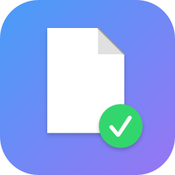
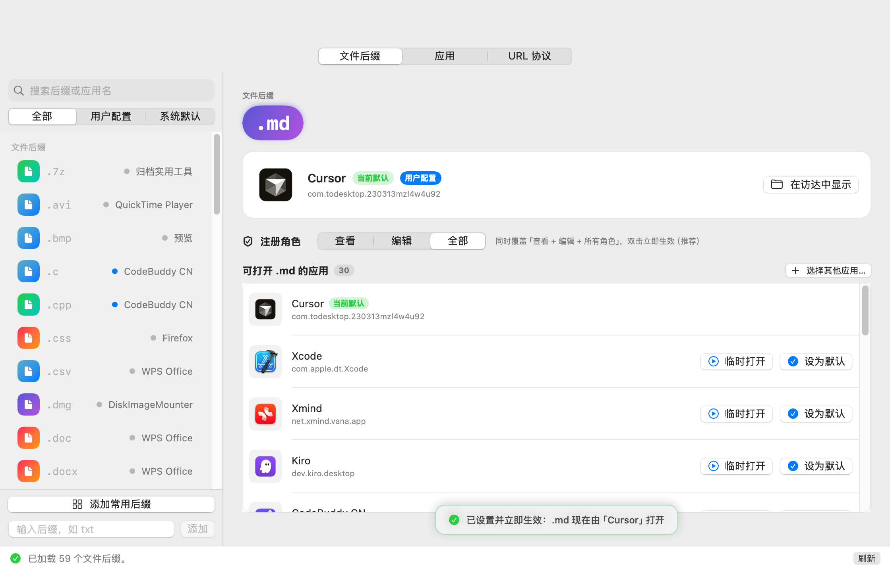

# DefaultApp（默认打开方式）

一个用于查看和修改 macOS **任意**文件后缀默认打开应用的轻量工具，
相当于 Windows 资源管理器的「打开方式 → 始终使用此应用」，直接基于 LaunchServices 实现。

语言 / Language: [English](README.md) | **简体中文**


<p align="center">
  
</p>
<p align="center">
  
</p>
<p align="center"><i>主界面（简体中文；内置 English / 跟随系统切换）</i></p>

## 功能

- **支持任意后缀**——不限于常见格式。直接输入任意后缀（如 `abc`），
  macOS 会自动解析为 UTI，即可为其指定默认打开应用。
- **实时显示当前默认应用**——每个后缀都可查看当前默认应用的图标、名称、Bundle ID，
  解析方式**与 macOS 双击打开完全一致**（`NSWorkspace`），而非仅角色注册接口；
  两者不一致时会明确警告。
- **设置后回验**——写入后立即通过「双击同款解析」回读确认，未生效会明确提示。
- **应用视图**——按应用查看后缀关系：它是哪些后缀的默认打开方式、可打开哪些后缀、
  以及它声明的文档类型。
- **区分「用户配置」与「系统默认」**——每个后缀的打开方式都会标记
  **用户配置**（用户显式设置，存储于 LaunchServices 用户偏好数据库）或
  **系统默认**（来自系统/应用安装时的声明），一眼看出哪些是你自己改的。
- **候选应用齐全**——从「所有声明可打开该类型的应用」中选择新默认，
  也可以通过文件对话框选择任意 `.app`。
- **角色注册**——支持查看 / 编辑 / 全部三种角色（`LSSetDefaultRoleHandlerForContentType`）。
- **常用后缀分类批量添加**——按文档 / 代码 / 图片 / 视频 / 音频 / 邮件 / 压缩 / 其他
  分类浏览，分类单选 + 后缀多选，一键批量添加。
- **检索与过滤**——按后缀名或应用名关键字搜索；支持按 全部 / 用户配置 / 系统默认 过滤。
- **首启预置列表**——首次启动自动填充各分类的常用后缀（文档/代码/图片/视频/音频/邮件/压缩），
  打开即见真实的默认打开方式；之后列表可自由增删。
- **应用内语言切换**——简体中文 / English / 跟随系统，工具栏一键实时切换。
- 后缀列表自动保存，重启应用后仍在。

## 构建与运行

```bash
./build.sh          # 构建 DefaultApp.app 与 lsctl 测试 CLI，输出到 .build/
open DefaultApp.app
```

要求：macOS 14+ 与 Xcode 命令行工具。无第三方依赖，应用已做临时签名（ad-hoc）。

## 实现原理

- 后缀 → UTI：使用 `UTType(tag: .filenameExtension)`（未知后缀通过动态 UTI 同样支持）。
- 查询当前默认：`LSCopyDefaultRoleHandlerForContentType`（依次回退查看/编辑/任意角色）。
- 枚举候选应用：`LSCopyAllRoleHandlersForContentType`（编辑 + 查看角色去重）。
- 修改默认打开方式：`LSSetDefaultRoleHandlerForContentType`。
- 用户/系统来源判定：解析
  `~/Library/Preferences/com.apple.LaunchServices/com.apple.launchservices.secure.plist`
  中的 `LSHandlers` 记录，并结合本工具自身设置过的记录。

修改立即生效——已通过真实打开文件做端到端验证。

## 测试 CLI

`build.sh` 会同时编译 `.build/lsctl`（同一 LaunchServices 封装的命令行工具）：

```bash
.build/lsctl get txt                     # 查看 .txt 当前默认应用（双解析对比）
.build/lsctl list png                    # 列出所有可打开 .png 的应用
.build/lsctl set txt com.sublimetext.4 all
.build/lsctl check                       # 列出「角色注册 ≠ 双击实际打开」的后缀
```

## 目录结构

```
Sources/App/                 应用源码（SwiftUI）
  MainApp.swift              入口
  I18n.swift                 应用内多语言（中/英）
  ExtensionCatalog.swift     常用后缀分类目录
  ContentView.swift          侧边栏：检索、过滤、批量添加面板、列表
  DetailView.swift           后缀详情与设置操作
  AppState.swift             数据模型、持久化、用户/系统来源判定
  LaunchServicesBridge.swift LaunchServices 封装 + 用户覆盖表解析
Sources/IconGen/             应用图标生成器（build.sh 自动编译运行）
Sources/TestCLI/             lsctl 测试 CLI
build.sh                     一键构建（图标 → 应用 → CLI → 打包 .app）
.github/workflows/           CI 与 Release 工作流
```

## 下载

[GitHub Releases](https://github.com/pengtianabc/DefaultApp/releases)
中提供 CI 构建好的 `DefaultApp.dmg` 与 `.zip`。

## CI / 发布

- 每次推送 / PR：在 macOS 运行器上构建并做冒烟测试（`.github/workflows/ci.yml`）。
- 推送 `v*` 标签自动创建 GitHub Release，附带 DMG 与 ZIP
  （`.github/workflows/release.yml`）：

```bash
git tag v1.0.0 && git push origin v1.0.0
```

## 许可证

MIT
